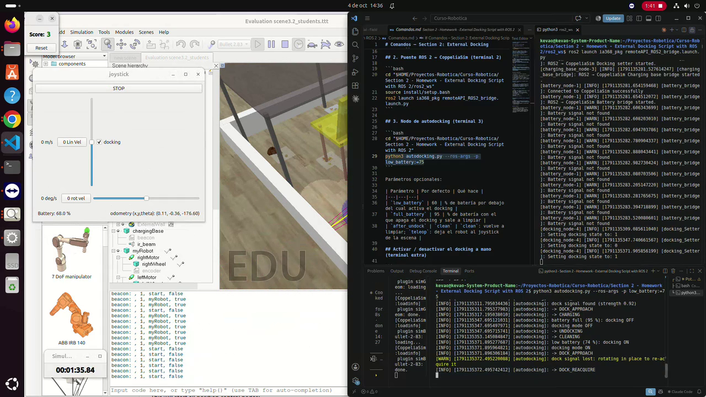
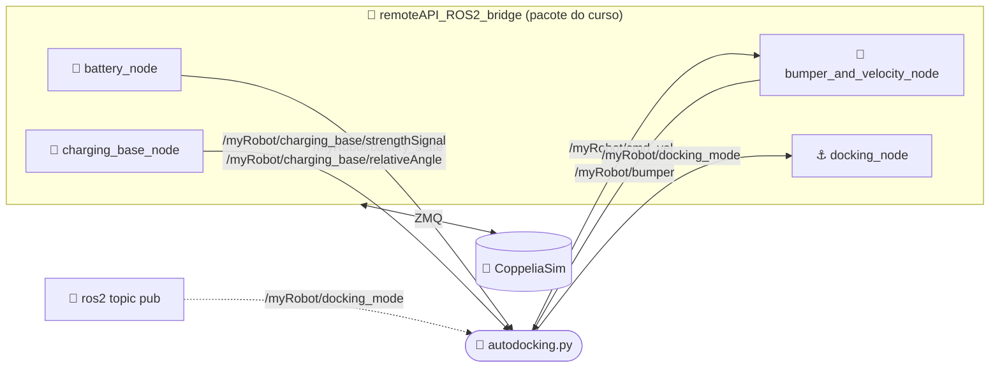
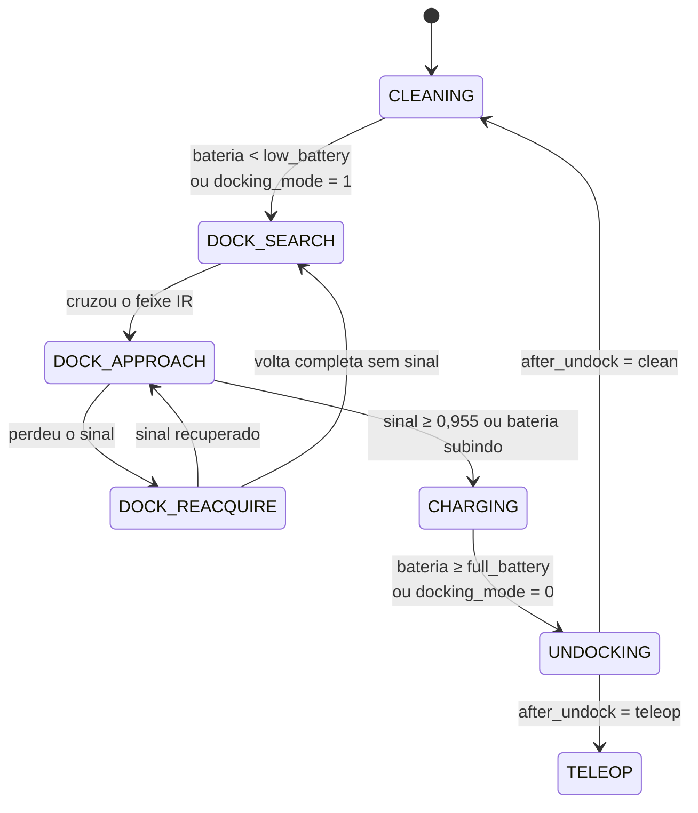

<div align="center">

# 🔌 Auto-Docking Externo com ROS 2

### O robô limpa a sala, percebe que a bateria está acabando, encontra a base de carga pelo feixe infravermelho e volta a limpar quando estiver carregado


**IA368 · Doutorado · UNICAMP · Seção 2**

[](docs/demo.mp4)

<sub>▶️ Clique na imagem para ver o vídeo da demonstração (3 min)</sub>

</div>

---

## 📌 Visão geral

Na tarefa anterior, a lógica de docking ficava **dentro** de um script do CoppeliaSim.
Aqui ela roda **inteiramente fora do simulador**, em um nó ROS 2 ([`autodocking.py`](autodocking.py)), conversando com o robô **apenas por tópicos ROS 2**.
O nó não usa a API remota ZMQ.

<div align="center">

| ✅ Verificado em simulação | |
|:---|:---:|
| Ciclos completos a partir do início da cena *(limpar → bateria baixa → buscar → acoplar → carregar → sair → limpar)* | **2 por execução**, em 2 execuções |
| Ativação manual por ROS 2 (`docking_mode` 1 / 0), inclusive desligando durante a carga | ✅ |
| Perda de sinal provocada durante a aproximação | ✅ recuperou e acoplou |
| Distância final do sensor ao feixe | **7–9 cm** (carrega a ≤ 10 cm) |

</div>

---

## 🧭 Arquitetura



| Tópico | Tipo | Direção |
|---|---|---|
| `/myRobot/charging_base/strengthSignal` | `std_msgs/Float32` | ⬅️ sinal da base: `1 − d/2 m`. Só existe dentro do feixe |
| `/myRobot/charging_base/relativeAngle` | `std_msgs/Float32` | ⬅️ ângulo até a base (rad, 0 = à frente) |
| `/myRobot/battery_state` | `sensor_msgs/BatteryState` | ⬅️ % e estado de carga |
| `/myRobot/bumper` | `geometry_msgs/Wrench` | ⬅️ força no para-choque |
| `/myRobot/cmd_vel` | `geometry_msgs/Twist` | ➡️ velocidade do robô |
| `/myRobot/docking_mode` | `std_msgs/Int32` | ↔️ liga/desliga o docking (1/0) |

---

## 🤖 Máquina de estados



| Estado | O que o robô faz |
|---|---|
| 🧹 **CLEANING** | Caminhada aleatória: trechos retos de 2,5–5 s, uma ré curta e um giro de "ricochete" de 115–230°. |
| 🔎 **DOCK_SEARCH** | A mesma caminhada, até o sensor de docking cruzar o feixe da base. |
| 🎯 **DOCK_APPROACH** | Gira para zerar o ângulo relativo e avança, desacelerando conforme o sinal fica mais forte. |
| 🔄 **DOCK_REACQUIRE** | Gira no lugar em direção ao último lado onde estava a base, até recuperar o sinal. |
| 🔋 **CHARGING** | Para e espera a carga. Se estiver parado e não carregar, avança um pouco mais. |
| ↩️ **UNDOCKING** | Dá ré para sair da base, gira 180° e volta a limpar (ou entrega o robô ao joystick). |
| 🕹️ **TELEOP** | Não publica nada: o joystick da cena comanda o robô. |

---

## 🔬 O que descobrimos sobre a cena (e como o nó lida com isso)

<details open>
<summary><b>📡 O feixe IR é um corredor estreito, não um cone largo</b></summary>

O sensor `ir_beam` da base é um leque plano: **5 cm de largura na base e 50 cm a 2 m**, com só 5 cm de altura.
O sinal aparece apenas quando o sensor de docking do robô **cruza esse corredor**. O sofá corta o feixe em y ≈ 0,4 m.
Por isso, a busca é uma caminhada pela sala, e ao detectar o sinal o robô **para na hora**, antes de sair do corredor.

</details>

<details>
<summary><b>🔄 Girar no lugar quase não move o sensor</b></summary>

O eixo das rodas fica 7 cm à frente do centro do robô, e o sensor de docking fica a só ~2 cm desse eixo.
Girar no lugar recupera o sinal quando o sensor ainda está dentro do corredor, por exemplo quando o sinal some ao corrigir a orientação.
Se o robô saiu lateralmente do corredor, depois de uma volta completa sem sinal ele volta à busca.

</details>

<details>
<summary><b>⚡ A ponte do curso multiplica a velocidade por ~10</b></summary>

O `bumper_and_velocity_node` converte `cmd_vel` usando o raio de roda do P3DX (0,0975 m). O controlador da cena divide de novo pelo raio do `myRobot` (0,05 m).
Resultado medido: `cmd_vel = 0,02 m/s` → **~0,19 m/s reais**.
O `autodocking.py` trabalha com velocidades **reais** e multiplica por `BRIDGE_SCALE = 0,0975` ao publicar.
Assim ele funciona com a ponte **original** do curso.

</details>

<details>
<summary><b>🛡️ O para-choque fica na traseira</b></summary>

Batidas de frente não aparecem no `/myRobot/bumper`; de ré, dão ~5 N.
Sem sensor frontal nem odometria em ROS, a limpeza usa trechos com duração limitada: um robô travado contra uma parede se solta no fim do trecho.
A ré é protegida pelo para-choque, e o robô sai da base dando ré.

</details>

<details>
<summary><b>🔋 Detecção de carga</b></summary>

A bateria cai 1 %/s e sobe 1 %/s carregando.
O sinal `Charging` da cena é apagado pelo script da bateria, então o `power_supply_status` às vezes não aparece.
Por isso o nó considera "carregando" também quando a porcentagem **sobe**.

</details>

<details>
<summary><b>🩹 Correção na ponte: a simulação congelava</b></summary>

O `bumper_and_velocity_node` original chama `sim.setStepping(True)` mas nunca chama `sim.step()`: **o tempo da simulação fica parado em 0**.
Além disso, ele roda um laço sem pausa, publicando o bumper a ~1800 Hz.
A cópia em [`ros2_ws/src/ia368_pkg`](ros2_ws/src/ia368_pkg/autodocking/bumper_and_velocity_node.py) tem **3 linhas marcadas com `# PATCH`**:

* comenta o `setStepping`;
* adiciona `time.sleep(0.01)` ao laço (~100 Hz).

O resto do pacote está intacto.

</details>

<details>
<summary><b>☑️ O checkbox "docking" da cena não chega ao ROS</b></summary>

O checkbox só faz `sim.broadcastMsg`, que nenhum nó ROS escuta. O caminho inverso funciona: ROS → `docking_node` → marca o checkbox.
Por isso o docking é ativado por **bateria baixa** ou por **`ros2 topic pub`**.

</details>

---

## 🚀 Como executar

**Requisitos:** ROS 2 Jazzy, CoppeliaSim 4.10 com a API remota ZMQ na porta 23000, `coppeliasim-zmqremoteapi-client` (para a ponte) e a cena `Evaluation scene3.2_students.ttt` do curso.

**1. Compilar a ponte** (uma vez):
```bash
cd ros2_ws
colcon build --symlink-install     # use um Python que tenha coppeliasim-zmqremoteapi-client
```

**2. Abrir a cena no CoppeliaSim**, sem dar play. A ponte inicia a simulação.

**3. Lançar a ponte:**
```bash
source ros2_ws/install/setup.bash
ros2 launch ia368_pkg remoteAPI_ROS2_bridge.launch.py
```

**4. Lançar o nó de autodocking** (precisa só de `rclpy`):
```bash
python3 autodocking.py --ros-args -p low_battery:=75
```

**5. (Opcional) Ligar/desligar o docking à mão:**
```bash
ros2 topic pub --once /myRobot/docking_mode std_msgs/msg/Int32 "{data: 1}"   # ON
ros2 topic pub --once /myRobot/docking_mode std_msgs/msg/Int32 "{data: 0}"   # OFF
```

### ⚙️ Parâmetros

| Parâmetro | Padrão | Descrição |
|---|---|---|
| `low_battery` | `60` | % abaixo do qual o docking liga automaticamente |
| `full_battery` | `95` | % em que o docking desliga e o robô sai da base |
| `after_undock` | `clean` | `clean`: volta a limpar · `teleop`: libera o joystick da cena |

> [!WARNING]
> * **Encerre com Ctrl+C.** Fechar o terminal deixa nós órfãos da ponte rodando, que continuam mexendo nos motores.
> * **Janela "Registration" do CoppeliaSim Edu.** Ela aparece de vez em quando e **congela a simulação**. Feche-a (*Cancel*).

---

## 📁 Estrutura

```text
.
├── autodocking.py                 ← o nó desta tarefa (só tópicos ROS 2)
├── ros2_ws/src/ia368_pkg/         ← pacote do curso (ponte), com a correção do stepping
└── docs/
    ├── demo.mp4                   vídeo da demonstração
    └── demo_frame.png
```

---

## 🙏 Créditos

O pacote `ia368_pkg` e a cena do CoppeliaSim são material da disciplina **IA368 (UNICAMP)**, do repositório
[cesarbds/IA368ii](https://github.com/cesarbds/IA368ii). Os arquivos `.ttt` não estão incluídos aqui.

São deste projeto o `autodocking.py` e a correção documentada da ponte.
